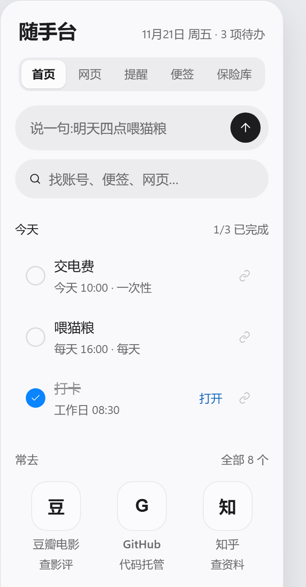
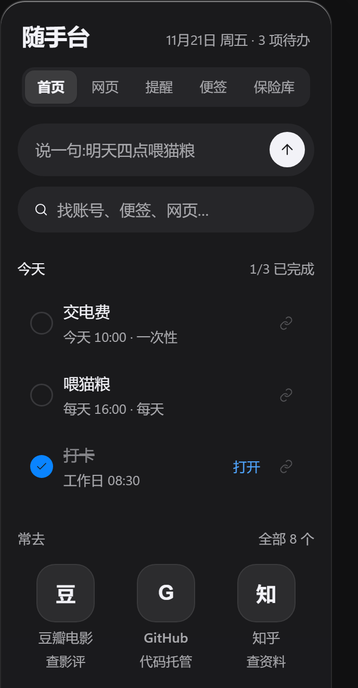

# dsh-desk-kit · 随手台

给 DSH 的一个插件:把**定时提醒、随手便签、网页收藏、加密保险库**放在一个手机式的面板里,
另带 **27 个 Agent 工具**,让模型能自己把话记进你的随手台。

数据只落在本机 `~/.dsh/desk-kit/`(可用 `DSH_HOME` 改根目录)。默认不发网络请求;只有你打开「网页用网站图标」、配置分类模型,或主动粘贴网页图片时,才会访问对应站点。

```bash
dsh plugin --profile desktop add github:Tera-Dark/dsh-desk-kit
```

| 浅色面板 | 深色面板 |
|---|---|
|  |  |

---
## 30 秒上手

装完重启 DSH,从这几个地方打开(有哪个用哪个):

| 入口 | 什么时候用 |
|---|---|
| 侧栏「随手台」标签页 | 日常主入口(需 `dsh-better-sidebar`) |
| 会话顶栏的剪贴板图标 | 正聊着天,顺手记一句 |
| `Ctrl/Cmd + Shift + K` | 手已经在键盘上 |
| 输入框敲 `/desk-kit` | 同上,不用记快捷键 |
| 设置 → 插件 → 随手台卡片 | 找不到入口时最符合直觉的地方 |
| 右下角浮标 | 没装侧栏插件时的兜底 |

打开后最上面就是一个输入框,**说人话就行**。存完会在顶部弹一条**分类提示**:
明确写着进了「便签 / 提醒 / 网页 / 保险库」、成功状态、事项标题和时间摘要,
几秒后自己淡出;想反悔可以直接点「撤销」,分错了还能点「转存到」。
存完**不会自己跳页**(连记三件事不用来回点「首页」)—— 想去那一类里看看,点提示里的「去看看」。

| 你说 | 它做的 |
|---|---|
| 帮我记一下，明天下午四点喂猫粮 | 提醒:2026-11-19 16:00(一次性,到点提醒) |
| 明天10点提醒我交电费 | 提醒:2026-11-19 10:00(一次性,到点提醒) |
| 每天晚上9点提醒我吃药 | 提醒:每天 21:00 |
| 周一到周五 8点半 打卡 | 提醒:工作日 08:30 |
| 记一下 周末去修耳机 | 便签 |
| https://example.com 这站不错,用来查资料 | 网页:名字取域名,用途进备注 |
| 示例站点账号 demo_user 密码 abc123 | 保险库:标题取域名,账号密码加密落盘 |
| 每月15号还信用卡 | 提醒:每月 15 号 09:00(没写几点先按 9 点,回执会说明) |
| douban.com 豆瓣电影,查影评 | 网页:开头写裸域名也算(不用非得 `https://`) |

**只有网址没有密码 / 账号 → 归「网页」**;必须真拿到凭据值才进保险库。
一句话里给了「备用码 / 恢复码」,会作为独立字段加密存进保险库,不塞进标题。

---

## 手机快捷录入(可选)

手机通过 DSH Pocket / DSH Mobile 访问后,可以把下面这个地址加到主屏:

```
https://你的DSH地址/?dk=capture
```

打开后会直接进随手台首页、聚焦输入框;处理完自动把 `dk` 参数从地址栏抹掉,
刷新或再次点主屏图标不会反复弹。也可以带一段预填文本:

```
https://你的DSH地址/?dk=capture&text=记一下周末修耳机
```

注意:桌面端随手台只接受本机 `Host/Origin`,直接用手机打开
`http://电脑局域网IP:3080` 会被 403。请使用会重写 Host/Origin 的移动网关
(例如 DSH Pocket),或自己的回环隧道。

---

## 四个分类

| 分类 | 能做什么 |
|---|---|
| **提醒** | 一次/每天/每周/每月/每年/农历生日;**默认准时**,可手动提前 1~10080 分钟;到点弹卡片,可「稍后 10/30/60 分」或「今天不再提」 |
| **便签** | 随手记;标签、置顶、完成、归档、垃圾箱;长文自动进「长期资料」并折叠;编辑时可逐张保留/删除图片;**常看/常复制的自动靠前** |
| **网页** | 卡片式列表:左边圆角图标(首字,开了「网站图标」再显示图标)、右边标题与域名、下面固定三行简介,卡片上直接复制链接;自动归一化网址、去 tracking 参数、同网址去重、按分类分组、**常打开的自动靠前** |
| **保险库** | 账号/密码/备用码/任意长文,**AES-256-GCM 加密**落盘;可归入「合集」集中查看;列表只显示标题,点「显示」才解密,明文 30 秒自动收起 |

四类之间可以互转:存完提示里有「分错了?转存到」,每条记录右侧也有 `⇄` 图标。
**转存先建新、成功才删旧**;成功后给「转存成功」回执;同一条连点几下只算一次
(服务端记转存台账,重复请求复用上次结果);带密码的保险库条目不许转到明文分类。

---

## 谁排前面

便签和网页的列表不用手动整理:顺序按「你到底用不用它」算出来。

1. **置顶**永远第一 —— 置顶就是你说「别动它的位置」。
2. 然后是**常用度**:用过几次(对数饱和,不会让一条看了两百遍的老记录永远霸榜)
   × 最后一次用是多久以前(10 天半衰)。
3. 次数一样时,**刚建的在前**(3 天的「新鲜」小额加成,过几天没碰就自然沉下去)。

于是新记的东西几乎总在眼前,一周前反复查过的那条会慢慢浮上来,三个月没碰过的落在最后。
便签的「看过一次」= 打开编辑或复制过;网页的 = 从面板点开过。
首页那块「最近记的」仍按**新建时间**排,它说的是最近,不是最常用。

---

## 保险库合集:把同类条目收在一起

保险库条目多了以后,一条条翻很费劲。新建/编辑条目时可以填一个**合集**名字,
列表顶部会出现合集按钮和条数,点一下就只看这一类。

- **一层,不嵌套**:合集就是名字,不建文件夹树,也不用手动维护目录;
- **可拖拽排序**:选中某个合集后,拖条目左侧的 `≡` 手柄上下挪;手机上没有拖拽,用 `↑↓` 按钮;
- **搜索仍跨合集**:搜索框会同时匹配标题和合集名,不受当前筛选限制;
- **不改变加密**:合集名和排序号只存在 `vault.json` 的明文元数据里,正文和附件照样加密;
- **超过 3 个自动收起**:先露 3 个和「更多 N」,点一下展开全部分类,不让一屏全是胶囊;
- **页头分开摆**:条数/合集数/加密状态在左,「新条目 / 附件」在右;条目本身也是「标题一行、动作一行」,
  长邮箱、长网址不会再被一排按钮挤成几段。

比如 15 条订阅链接可以都填「梯子订阅」,点一下合集就只看这 15 条,顺序也能按常用程度排;
谷歌账号也可以统一放进「谷歌账号」合集。

---

## 附件:截完图直接粘贴

| 怎么给 | 结果 |
|---|---|
| 面板里任意位置 `Ctrl+V`(截好的图) | 立刻存成一条便签,提示里带撤销 |
| 便签页 → 新便签 → 粘贴 / 拖文件 | 挂在草稿上,写完字一起保存 |
| 便签页 →「附件」/「读剪贴板」 | 文件选择器(任意格式),或直接读系统剪贴板 |
| 保险库 → 新条目 → 粘贴 /「附件」 | 和正文一起加密,点「显示」才看得到 |
| 便签 → 编辑 →「图片/附件」区 | 图片作为独立单位显示,点右上角 `×` 可单独删掉,保存后才清原件 |

- 缩略图 64px,点开看大图(`Esc` 关闭),右下角直接下载;非图片显示扩展名。
- **从别处复制图片**:有文件就按文件存;网页图片(只有 `` 地址)交给宿主下载后落盘;
  如果剪贴板里只有一个本地路径,会明确提示「浏览器读不到这个文件」,不会再把这行路径当文字粘进便签。
- 单个 24MB,每条最多 12 个;**保险库名下的附件落盘前整块加密**。
- 附件原件在 `~/.dsh/desk-kit/blobs/`,**不在导出的 JSON 里** —— 完整备份要连目录一起拷。

---

## 搜索与清理

**首页快搜**:一个输入框搜全库 —— 便签(正文/标签)、提醒(标题/备注)、网页(标题/网址/备注/分类)、
附件(文件名)、保险库(标题)。中英别名互通:搜「脸书」也能命中写着 `Facebook` 的条目。

- 结果只给「哪一类 + 命中字段 + 一小段摘要」,不会拼出第二份正文。
- 保险库默认只搜标题;标题没命中时可以点「在内容里再找一次」,显式解密后在内存里比对,
  结果只回「保险库 · 内容命中」,不回传字段值。
- 点结果直接去对应页面:便签带着关键词进便签页;保险库会自动滚到那条并展开,30 秒后收起。
- 保险库可以按「合集」收拢同类条目;搜索会同时匹配标题和合集名。

便签页顶部的搜索框也走同一套跨库逻辑,适合已经在便签页时直接找。

**清理**在 设置 →「存储与清理」:

```
存储与清理                       共 24.8MB
附件        ████████████████░  21.9MB
便签/提醒   █░░░░░░░░░░░░░░░░   1.4MB
保险库      █░░░░░░░░░░░░░░░░   1.5MB
垃圾箱                            3 条待清
保留                    [7天] [30天] [90天] [不清]
这些会被自动清掉(想留就先恢复):
  网页   example.com            下次清理就清掉
  便签   登录页改版,留着对比        还有 4 天
```

- 清三种东西:过期垃圾箱记录(连附件原件)、宿主已不存在的附件、传上来一天没挂上的临时附件。
- **保险库不参与自动清理**(删即不可恢复);保留 0 天 = 不自动清。
- 自动清理每 6 小时最多一次(DSH 开着时),也可以点「现在清理」立刻跑。

---

## 安全边界(先说清楚,别高估)

| 谁 | 能拿到吗 |
|---|---|
| 局域网里的其他设备 | **不能** — 接口只认回环地址,来源不对直接 403 |
| 你浏览的网页 | **不能** — 无 CORS 放行;写操作要自定义头 `x-desk-kit`,跨源过不了预检 |
| 随手翻 `vault.json` | 只有密文 |
| **能读 `~/.dsh/desk-kit/` 的人** | **能解密** — `vault.key` 与密文同目录。这是当前设计的天花板 |
| 本地其它程序 | 能 — 同权限进程可以读文件、也可以调接口 |
| 同步盘 / 云备份 | 会跟着走 — 不要把这个目录放进 OneDrive/iCloud |

完整版(含「想更稳该做什么」)见 [`docs/SECURITY.md`](docs/SECURITY.md)。

---

## Agent 工具(27 个)

| 分组 | 工具 |
|---|---|
| 一句话入口 | `desk_capture` |
| 便签 | `desk_note_add` `desk_note_list` `desk_note_update` `desk_note_delete` `desk_note_restore` `desk_note_purge` `desk_note_complete` |
| 提醒 | `desk_reminder_add` `desk_reminder_list` `desk_reminder_checkin` `desk_reminder_delete` `desk_reminder_restore` `desk_reminder_purge` `desk_due` |
| 保险库 | `desk_secret_add` `desk_secret_list` `desk_secret_get` `desk_secret_delete` |
| 网页 | `desk_link_add` `desk_link_list` `desk_link_delete` |
| 附件 | `desk_file_add` `desk_file_list` |
| 查找 / 维护 | `desk_search` `desk_cleanup` `desk_item_move` |

对 Agent 说这些话就会命中:「记一下:周末去修耳机」「提醒我每天 9 点吃药」「我今天打卡了」
「把某站账号 demo_user / 密码 xxx 存起来」「把那张截图存起来」「我之前记过什么?」

---

## 数据目录与备份

```
~/.dsh/desk-kit/        # 默认;DSH_HOME 可改根目录
├── data.json   便签 + 提醒 + 网页 + 附件元信息 + 告警(明文,可 cat/diff)
├── vault.json  保险库条目(每条独立 AES-256-GCM 密文)
├── vault.key   主密钥材料(0600;丢了 vault.json 就解不开)
└── blobs/      附件原件(普通 .bin,保险库名下 .enc)
```

设置页可以「导出为 JSON」;提醒和便签是明文,保险库导出的是密文。
**导出不含附件原件**,换机器要连 `blobs/` 一起拷,并且带上 `vault.key`。

---

## 开发自测

```bash
npm test            # 文档一致性 / 存储 / 分拣 / 农历 / 粘贴图片 / 客户端渲染 / 归属 / AI 分类 / 入口
npm run check:docs  # 只查文档:版本号三处一致、docs 齐全、本地链接不断、测试文件都已纳入 test
npm run test:host   # 桩掉 webServer,真起 HTTP:API、27 个工具、附件、转存、清理、导入
npm run test:installed  # 按装好的样子加载一遍
npm run test:ui     # 真浏览器里点一遍:粘贴截图 → 缩略图 → 大图 → Esc → 搜索 → 提醒 Enter → 深链录入 → 分类提示自动消失
```

需要 `react` / `react-dom`:从 DSH profile 里取,没有就装在本仓库。

**改客户端改 `src/client/*.js`,不要直接改 `client.js`** —— 后者是拼接产物:

```bash
npm run build        # src/client/*.js → client.js(按文件名顺序拼)
npm run build:check  # 只看「产物是否与源码一致」,npm test 会自动先跑它
```

宿主只加载 `client.js` 一个文件(单文件 bundle,不能 `import`),所以用拼接换可维护性,
不引入打包器、不引入运行时依赖。

---

## 变更历史

逐版本的「为什么 + 验收」都在 [CHANGELOG.md](CHANGELOG.md)。当前版本 **1.32.2**。
改过哪些问题、还剩哪些没修，看 [docs/ISSUES.md](docs/ISSUES.md)；界面基线与 token 约定见 [docs/DESIGN.md](docs/DESIGN.md)。
